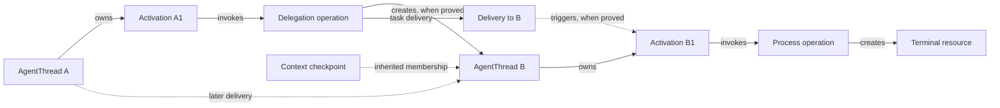
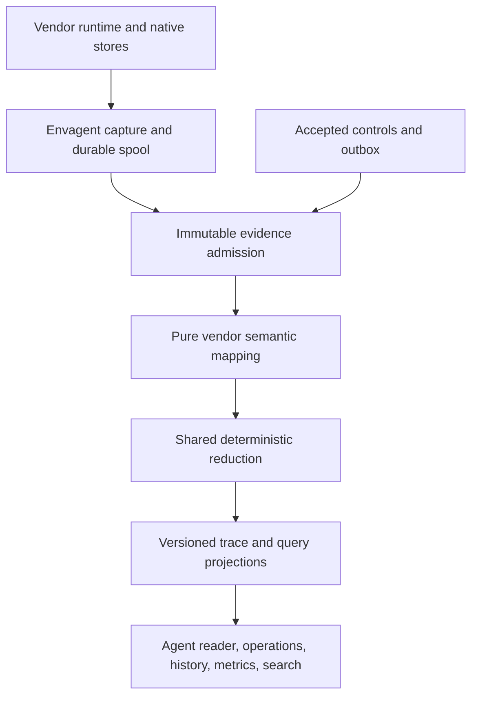

# Unified Trace Foundation

Status: **Normative target design. Implementation and production conformance are pending.**

Design review: 2026-09-15. Progress and rollout gates live only in
[roadmap.md](roadmap.md#unified-trace-foundation-review).

## Purpose and authority

This document defines the common record between vendor adapters and every Sylph reader.
The record models agent work before deciding how to display it. Existing blocks,
execution trees, turn containers, and frontend components impose no constraint on it.
There is no compatibility reader, schema migration, or dual-write adoption period.

This specification owns trace semantics. [unified-trace-storage.md](unified-trace-storage.md)
owns durable capture, reduction, physical storage, publication, and bounded reads.
[unified-trace-conformance.md](unified-trace-conformance.md) owns evidence and acceptance.
The vendor mappings are [Codex](unified-trace-codex.md),
[Claude Code](unified-trace-claude.md), and [Pi](unified-trace-pi.md).
[unified-trace-ui.md](unified-trace-ui.md) consumes these contracts; it cannot redefine them.

[architecture.md](architecture.md) continues to own environment and public Session
identity, authorization, and outward envagent connections. Its trace boundary points here.
Where the former event/block protocol conflicts, this target replaces it; the affected
owners explicitly mark their superseded sections. A spec preceding implementation does
not assert that current APIs already provide it.

## First principles

The irrecoverable asset is what a source actually recorded. Interpretations, indexes,
groupings, summaries, and presentation can be rebuilt. Therefore evidence is immutable
and authoritative, interpretation is versioned, and neither transport nor rendering
is allowed to become the domain model.

A reader focused on any agent can ask:

- What arrived, who authored it, and what is known about its delivery or consumption?
- What execution began, what did it produce, and what ended that execution?
- What did it invoke, what returned to each recipient, and what continued running?
- Which other agents did it create or contact?
- Which history and context did it inherit or select?
- Which claims are measured, inferred, conflicting, or simply unavailable?

These questions have the same answers while streaming, after import, after restart,
and after re-projection at the same evidence cut and mapper version. Lower-resolution
sources provide fewer answers, not a different class of session.

Sylph records work. It does not become a model scheduler, promise hidden reasoning,
or claim executable context reconstruction when a source omits the actual request.
An OpenTelemetry-style span tree alone cannot represent reusable agents, mailbox
delivery, context branching, or resources surviving their callers. A chat-message list
alone cannot represent those things either. Both can be useful projections of this
record; neither is its storage primitive.

## Semantic objects

The following are closed core types. Their required relations are typed fields or
typed facts, not unvalidated labels in a generic graph. Vendor extensions retain extra
detail but cannot replace core identity, ownership, ordering, or outcome fields.

| Object | Meaning and minimum contract |
| --- | --- |
| AgentThread | One independently advancing agent conversation; `agent_ref`, vendor, optional evidenced name/model, existence and lifecycle claims |
| Activation | One observed execution interval; `activation_ref`, owning agent, boundary evidence, triggering deliveries, own outcome |
| Message | Authored content; `message_ref`, author, protocol role if known, purpose if known, immutable content revisions and ordered parts |
| Delivery | One attempt/occurrence of routing content; `delivery_ref`, sender, recipient, route, immutable observed revision bindings and independent stage evidence |
| Operation | One invocation; `operation_ref`, owner agent, typed requester, optional known activation, category, input revision, result occurrences, own lifecycle |
| Resource | An identified entity that outlives an invocation; `resource_ref`, creator/host if known, kind, independently observed state |
| HistoryEntry | One native or observed history position; `entry_ref`, containing agent, predecessor and original-owner evidence; immutable content observations bind its ordered slots separately |
| HistorySelection | An immutable head or included membership description, and a separate observation selecting it for an agent |
| ContextCheckpoint | What context is known at a boundary; owner, included references or opaque replacement, basis and coverage |
| Measurement | A reported quantity; identity, scope, metric, unit, interval/counter domain, value, reporting evidence |
| Payload | Immutable bytes or a manifest of immutable segments; digest, length, media/encoding, representation, available ranges, source evidence |

An Activation is not a human turn. An input can be queued without starting one, multiple
deliveries can trigger one, and steering can enter one already in progress. Content with
no reliable activation association remains attached to its known agent and history
entry; the adapter does not invent a turn to hold it.

An AgentThread is not an Operation. An operation can fail before a child exists, and
one child can accept many later tasks. An operation containing nested tool executions
is still an operation unless actual evidence identifies an independently advancing agent.

### Ownership, topology, interaction, and context

Every Operation and Activation has exactly one owning AgentThread. An unresolved owner
is a typed unresolved reference, never a default to the current root. Once established,
ownership does not move because a result arrived during a later activation. A Message's
author and original production scope are distinct from the agent whose history contains
an entry referring to it. One message revision can be delivered more than once.

Four relations must remain separate:

| Relation | Contract |
| --- | --- |
| Spawn | A child has at most one proven spawn parent in these vendors; no cycles; failed attempts are operations without invented children |
| Interaction | Directed task, message, result, wait, or close interactions; may be many-to-many and cyclic across agents |
| History predecessor | An acyclic native entry/history graph; may branch inside one AgentThread |
| Context lineage | Included/replaced context with original-owner references; does not establish new execution or spawn parentage |

The source can identify a real child before its transcript is available. That child has
an AgentThread with unavailable interior. A target handle whose meaning or existence is
unproven remains an unresolved reference outside the directory count. A wait result or
activity notification is not itself proof of a new child.



## Identity and reference resolution

Public `SessionId` remains `(environment, agent, native_id)`, encoded as specified in
[architecture.md](architecture.md#identity-is-environment-agent-native_id). Trace objects
have typed addresses, not a second Sylph-generated Session UUID.

The reference algebra is:

```text
AgentRef = Session(SessionId)
         | Embedded(anchor_session: SessionId, namespace, native_child_id)

ObjectRef<T> = Native(scope_ref, vendor_namespace, native_key_tuple)
             | Occurrence(scope_ref, source_ref, generation, position, local_slot)

ObservationRef = (environment_or_server, producer_id, producer_epoch, producer_seq)
SourceRef = (issuer_environment_or_server, durable_source_instance)
SourcePosition = (source_ref, generation, locator_kind, locator)
```

`Embedded` addresses a vendor's actual child identifier scoped to an existing native
session. It neither reserves a public Session row nor pretends that the vendor can
resume it as a standalone session. Root and embedded agents use identical trajectory
types and read APIs; reachability remains a separate fact.

Native key tuples include the vendor's actual uniqueness scope. A Claude content part
may need native record UUID plus block index; a terminal handle needs its runtime
incarnation; a tool call needs its caller's namespace. Timestamps, names, model labels,
file paths, global block indices, and payload hashes are not object identities.

Occurrence keys are deterministic addresses for things a source recorded without a
native ID. They do not masquerade as vendor IDs. `local_slot` is a mapper-defined stable
structural selector within that occurrence, such as a JSON pointer and part index. Keys
are length-delimited typed tuples internally; opaque URL encoding must be round-trippable
and cannot introduce delimiter collisions. Do not lowercase opaque vendor identifiers.

### Evidence identity is not semantic equivalence

Transport redelivery reuses ObservationRef. A native reread may have a new transport
receipt but the same SourcePosition and same bytes. That produces another receipt of
one source occurrence, not new content. Different bytes at that position are a capture
conflict or explicit source revision, never an in-place overwrite. Explicit deletion
and re-adoption introduce a new authorized admission epoch for retention, not a new
vendor occurrence identity; old receipts cannot restore erased bytes. The storage
contract defines that boundary.

Two source occurrences with identical bytes remain distinct. Live and native observations
refer to one semantic object only if the mapping provides proof: a shared scoped native
ID, an explicit correlation record, or a verified source-defined mirror/lineage rule.
Text equality, timestamp proximity, matching tool names, and matching list lengths
cannot prove equivalence. Uncorrelated observations remain inspectable with their source
coverage; a view may select a declared source surface without claiming the observations
are duplicates.

An equivalence claim includes the two same-kind references, evidence, and rule. Its
publication validates environment, ownership, and namespace constraints. A projection
may resolve multiple issued references to one entity, but all issued references remain
resolvable; clients anchor to a reference, not an internal representative. The
representative is deterministic from the equivalence class, independent of arrival order.
This registry records actual domain identity, not compatibility aliases for renamed APIs.

Incorrect equivalence can be withdrawn by a supported correction or a new mapper
generation. Original addresses and owner claims remain in evidence, allowing the class
to split without rewriting source records. Merge operations are not destructive SQL
rewrites of foreign keys. A conflicting ownership claim is quarantined, not an excuse
to move a body under a different agent.

## Messages, deliveries, and model visibility

Message authors are typed `human`, `agent`, `harness`, `tool`, `external`, or `unknown`,
with an identity where available. Protocol role describes a vendor/model format and
cannot establish authorship. Purpose is independently evidenced: task input, progress,
answer, context, notice, or unclassified. An assistant sentence is not necessarily a
final answer; a user-role wrapper is not necessarily human speech.

Content parts preserve order and kind: text, disclosed reasoning, image, audio, video,
structured data, attachment, or opaque vendor content. An unknown part is retained and
reported, never discarded because the default reader has no renderer for it. Encrypted
or undisclosed reasoning stays opaque and is never reconstructed.

Each content revision is immutable. An edit to queued human input creates a revision;
dispatch records the exact revision and its bytes. Native transformed input is another
representation with provenance, not a replacement for what the user submitted. A vendor
stream can establish successive message revisions under the streaming rules below.

A Delivery's stable routing identity is separate from its immutable revision-binding
observations. Reobserving one proved native admission does not create a second delivery
because another source gives its content a distinct observed revision reference. Bindings
retain every supporting claim and exact revision; differing content remains ambiguous
unless a field-specific correction establishes it. Selected reads restrict delivery
bindings to their eligible content observations. A server dispatch still binds exactly
the accepted revision it sent; a queue edit creates a new revision-specific delivery,
and native wrapping cannot substitute that submitted content.

Delivery records these independently evidenced stages:

| Stage | Claim it supports |
| --- | --- |
| Requested | Sender attempted delivery of this revision to this recipient |
| Accepted/queued | Receiver or mailbox accepted it; execution and consumption are not established |
| Admitted | Content entered the recipient's conversation/history surface |
| Included | A specified inference request/checkpoint contains it, with exact/range coverage |
| Rejected/cancelled | The attempt failed or was cancelled within the source's stated scope |

These are facts, not a mandatory ladder. A native store may prove admission without
showing the earlier request. Queue acceptance can later be cancelled. Inclusion names
the particular inference or context; it does not imply that every later model call used
the message. Deduplicate a command receipt by command identity, and a mailbox occurrence
by mailbox identity, never by text.

A cause relation from a Delivery to an Activation is published only with actual boundary
correlation. Accepted input can wait indefinitely or deliberately avoid triggering the
agent. A steering receipt remains attached to its delivery even if the active execution
ends before a consuming model request is observed.

A child's produced answer and a parent's delivered notification are separately addressed
occurrences, even when both reference the same bytes. Operation output may be useful to
a human reader without any assertion that the model saw it.

## Execution, results, and resources

### Independent lifecycle claims

Activation and Operation state describes their own execution: known started, known
terminal, or unresolved. Terminal outcomes are `succeeded`, `failed`, `cancelled`,
`interrupted`, or `unknown`; a source reporting only termination gets `unknown` outcome.
Close reason is a separate typed fact, such as vendor stop, budget exhausted, server
interrupt, process exit, or observation loss. An absent result is not success.

Observation state is independent: following, complete through a stated cut, gap,
unavailable, or conflicted. A link disconnect does not close remote work. A confirmed
local process exit can end work owned by that process, but a parent activation ending
cannot sweep children, terminals, or independent cells closed. On restart, unconfirmed
execution displays an unknown current state; historical start evidence remains true.

AgentThread availability and vendor closure are distinct from an activation's terminal
outcome. A final answer does not close an agent. An activation can succeed after failed
tools; diagnostic counts cannot replace its own outcome. A terminal activation can
continue receiving late evidence without reopening execution.

Server-requested interruption, observed process termination, and vendor-reported outcome
are separate claims. A command accepted for cancellation does not prove execution stopped.
Where claims disagree, field-specific authority and explicit correction decide the
resolved value; a generic later notification cannot overwrite a detailed terminal error.

### Operation contract

The common operation fields are:

```text
Operation {
  ref, owner_agent, activation_ref?, requester_ref?, category,
  input_revision?, argument_state,
  result_occurrence_refs[], resource_refs[], nesting_claims[],
  execution_claims[], coverage
}
ResultOccurrence {
  ref, operation_ref, recipient_ref?, disposition,
  representation, payload_ref?, delivery_ref?, evidence_refs[]
}
```

`argument_state` is collecting or sealed. Sealed arguments do not mean the operation
ran or completed. Disposition distinguishes progress, yield, final return, and refusal
where evidence supplies that meaning. An orphan result preserves its call reference
and evidence; it does not need invented invocation arguments.

Categories provide typed fields for tool, inference, delegation, communication, wait,
terminal I/O, code cell, edit, and extension operations. They are semantic contracts,
not a global list of names that promotes any tool called `Agent` into a child. The
vendor adapter establishes what its actual API did.

| Case | Required representation |
| --- | --- |
| Background command | Launch Operation, returned handle, terminal Resource; later poll/stdin Operations reference that Resource; process exit closes Resource |
| Yielded code cell | Code-cell Operation and independently tracked execution/resource if exposed; initial yield and later return are different result occurrences |
| Nested tools | Nesting edge only when a runtime records the enclosing call; JavaScript source is not proof that a nested invocation executed |
| Delegation | Invocation plus actual child identities, task deliveries, and source outcomes; wait/follow-up does not create a child |
| Inference | Only observed model invocation; exact request/context, output and usage remain separately evidenced |
| Edit | Proposed edit input, observed execution result, and available before/after artifact; success does not establish a diff the source never captured |

Nesting and causality differ. A later wait can observe a cell's result without becoming
the owner of everything the cell executed. Independent runtime calls absent from a
model-visible wrapper stay independently inspectable with unknown nesting.

### Payloads and streaming

Three representations are first-class: runtime observation, immediate caller result,
and recorded conversation content. The third carries its Delivery stage: admitted-only
content is not labelled included in model context without named inclusion evidence. Each has its own payload reference and
transformation evidence. Truncation in the caller's result cannot erase a retained
runtime output; a full runtime output cannot silently replace what the caller saw.

Payload manifests reference immutable byte chunks and ordered part/range mappings.
They record media type, encoding, decoded byte length if known, and completeness:
complete, known ranges, truncated, source-redacted, opaque, or unavailable with reason.
Missing lengths remain unknown. An empty complete payload is distinct from no payload.
Access denial is not stored as a coverage defect; it belongs to the requesting Subject.

Streaming capture preserves append segments, replacement snapshots, and final values.
Segment identity comes from source occurrence and part scope. Identical repeated deltas
remain repeated. A snapshot starts a new immutable revision and explicitly covers the
source prefix it replaces when known; it is never assumed equal to concatenated deltas.
Late observations are retained. They alter a sealed projection only through a declared
revision/correction rule; an ordinary late delta cannot reopen a sealed message.

Payload storage can compress exact bytes and segment boundaries. Encoding every stream
as offsets into one final string is allowed only when that source stream is verified
append-only and the final string exactly matches; otherwise it would lose replacement,
truncation, refusal, or corrected content. Previews are derived and never archival bodies.
Chunked reads and UTF-8 decoding preserve byte boundaries without interpreting binary
or JSON bodies as line-oriented text.

## History, context, and durable work

### Entry graphs and selected history

There are three distinct orders: occurrence order in captured sources, native history
predecessors/membership, and the reader's chosen deterministic order. Pi can branch
inside one native session; Codex can preserve thread identity while selecting another
physical rollout. A linear message array plus parent session ID cannot encode either.

A HistoryEntry references its native predecessor when recorded. Multiple children of
one predecessor are alternative paths, not duplicate user inputs. Native files can also
hold non-history telemetry, so source record offset is not automatically a history-entry
ordinal. Adapter specs define the conversion and whether boundaries include the header.

Entry topology and observed content are separate facts. A content observation names the
entry, exact source position, mapping rule, ordered slot bindings and their completeness.
Its ClaimRef identifies the immutable observation; each slot references a message
revision, operation, checkpoint or opaque payload. Slots use the mapper's stable
structural coordinates, never a body digest or revision identity. Keep bindings from one
observation grouped: combining unrelated partial observations cannot manufacture a
complete content sequence that no source observed. No observation means unknown content;
an explicit complete empty observation establishes an empty entry.

Reobserving one proved native entry may add distinct immutable content revisions without
changing its predecessor graph. Content disagreement therefore cannot remove the entry
or its descendants. Different messages or incompatible content within one slot remain
explicit alternatives/conflicts, with their observation evidence available for inspection.

A HistorySelection contains a typed `EntryPath(head_entry_ref)` / `EntrySet(entry_refs)`
or ordered `SourceExtent(source_ref, generation, coordinate, start_inclusive,
end_exclusive, mapping_rule, original_owner)` values, plus excluded branches when known.
`coordinate` is tagged `vendor_ordinal(domain_ref)`, `local_record_index`, or
`byte_range`; units cannot be mixed. A recorded Codex ordinal can continue at a nonzero
baseline after revert, so it is not the physical line number minus one.
A raw extent includes header/telemetry occurrences as evidence, but only the mapping
rule selects semantic history members. It never promotes a copied header or inherited
operation into child-local identity, configuration, or execution. A separate observation selects it. Its closure may refer to
previous immutable selections; implementations index membership rather than recursively
loading an entire lineage on every query. Selection, source file generation, and context
checkpoint each have their own identity.

Selected membership retains eligible content-observation references as well as entry
references. A source extent admits only the content observations proved at its selected
source positions and mapping rule. Inherited selections preserve those bindings; they
cannot expand to every later observation of an inherited entry. An entry path or set
can carry an explicit observation scope when a vendor snapshot supplies one. A bare
head/path establishes topology only: the reader considers observed alternatives at its
query cut and does not claim a source-selected content revision. A retained query snapshot
pins both topology and content bindings.

Readable presentation is separate from revision identity. After restricting candidates
to the selected bindings and one proved Message identity, explicit append, replacement,
final and correction rules apply. Otherwise competing complete candidates can provide
one readable value only when their ordered kinds, MIME types, encodings, immutable
payload descriptors and completeness agree. Pick a deterministic eligible representative
for rendering while retaining every revision and proof; this creates no equivalence or
content-based identity. Unknown descriptors remain unknown, differing values remain
conflicted, and distinct messages/deliveries remain distinct even when bytes match.

Selecting another branch or reverting does not delete old work, change its author, or
create a new AgentThread. Default selected-history reads exclude discarded suffixes;
archive reads can inspect them explicitly. When head selection is not recorded, the
API reports candidate heads and unknown selection. It never picks newest mtime or latest
capture as truth. The UI can let a person inspect a candidate without rewriting source
selection. Each aggregate says whether it covers selected history, local authored work,
or the entire retained archive.

### Inheritance, compaction, and fork

Copied history entries refer to their original owner whenever lineage proves it.
The inherited prefix is context in the child, not child-authored messages or rerun tools.
If the original transcript is absent, retained copied bytes remain readable with the
known original-owner reference and an explicit unavailable origin. Unknown lineage is
not an invitation to use body hashes to merge unrelated work.

A ContextCheckpoint describes known context inclusion, replacement, or summary. Exact
context requires the observed ordered request or replacement set, settings and payload
references; a summary alone supplies only summary coverage. Compaction changes model
context, not the append-origin historical record. It never authorizes evidence deletion.

Context membership is a separate typed relation from a checkpoint to an immutable
HistorySelection, identifying included, preserved or replaced members. Later evidence
can establish membership without rewriting the summary payload or claiming that the
summary alone was an exact model request. Missing source/predecessor evidence leaves
membership unresolved; an explicit complete mapping witness is required to conclude
that a source extent contains no semantic entries.

A fork creates a new native session and records context lineage. Spawn ownership,
logical fork boundary, physical base rollout, inherited-prefix end, and selected history
head may all differ. An adapter maps each actual field; it cannot collapse them into
one `parent_id`.

### Goals and schedules

A goal is an identified Resource across activations. Its state updates are neither
conversation replies nor execution boundaries. A continuation has a sourced Delivery
and an ordinary Activation only where native evidence provides the boundary.

Sleep is a wait Operation. An externally managed schedule is a Resource whose
registration, cancellation, and firing are separate facts. Registration success does
not prove firing. A firing can cause a delivery; the trace does not run that scheduler.

## Ordering, clocks, and measurements

Capture/source order, server admission order, causal edges, and native history membership
are stored independently. Receipt order provides deterministic archive replay; it is not
the agent's causal order. Timestamps never decide identity or equivalence.

Within a selected agent history, verified predecessor/order edges constrain reading
order. Unordered components use a deterministic lexicographic tie-break over typed
source occurrence keys. Such ties carry `order_basis = presentation_tiebreak`, never
pretend to be measured causality. A contradictory order edge is retained as a conflict
and excluded from the valid ordering graph. Incremental and cold reduction of a cut
produce the same ordering. Late evidence may reposition an entry; revision-pinned
pagination and explicit move patches preserve the reader's address.

Time evidence names a clock domain, value, unit, precision, and basis. Source wall time,
source monotonic duration, and server receipt time do not substitute for one another.
Both endpoints in a compatible clock domain establish elapsed time only; a vendor's
reported execution/active duration is a separate metric with its documented scope.
Negative or reset clocks produce a diagnostic, not an absolute-value duration.
Missing endpoints produce unavailable duration. Parallel work is never summed into
wall elapsed time.

Every Measurement identifies:

```text
measurement_ref, subject_ref, metric, unit, value,
mode = interval | cumulative | gauge,
interval_ref? | (counter_domain, reset_epoch, sample_position)?,
aggregation_scope, component_relationships, evidence_refs
```

Usage per response, activation, thread, or root-task aggregate remains distinct. Native
response IDs are used when exposed. A cumulative delta requires a compatible baseline
in the same counter domain and reset epoch. Repeated snapshots do not add usage; zero
is not substituted for an unknown baseline. Inclusive ancestor totals cannot be added
to child totals without proven disjoint scopes. Cached and reasoning token components
retain the vendor's inclusion rules. Monetary cost needs currency and pricing basis;
tokens alone do not prove cost. Measurements never split messages or create prose rows.

## Evidence, claims, and deterministic reduction

An observation records the complete vendor frame/record or server-authored fact and its
source envelope. Semantic mapping produces claims with:

```text
claim_ref, fact_kind, subject_ref, typed_value,
evidence_refs[], rule_id, mapper_build,
supersedes_claim_refs[], source_revision?
```

Core fact families cover object declaration, message revision, delivery stage,
execution boundary/outcome, operation result, resource state, relation, history entry,
history selection, context checkpoint, measurement, coverage, and diagnostic.
Required fields for each family are typed. Unsupported vendor detail stays in retained
evidence with a surfaced diagnostic/coverage effect; an empty successful parse is invalid.

Claims are interpreted evidence, not another authority. A new mapper can withdraw a
previous interpretation by rebuilding a generation; source bytes survive. Core field
resolution is deterministic and specific:

| Field | Resolution rule |
| --- | --- |
| Identity and owner | Explicit native scope/correlation only; incompatible claims conflict |
| Human submitted content | Accepted server revision is immutable; native forms are related representations |
| Delivery | Keep separately proved stages and attempts; accepted is not included |
| Outcome | Detailed terminal native evidence applies to its named subject; explicit source correction supersedes; generic item status cannot replace it |
| Content | Scoped native revision/segment rule; no concatenation after final without an evidenced revision |
| History selection | Explicit selection observation in its own source order; unknown when unavailable |
| Observation coverage | Accumulate evidenced intervals and gaps per dimension; no single strength ranking |

No global last-arrival-wins rule or global numeric evidence-strength enum exists. Two
incompatible un-ordered equally authoritative claims expose `conflicted` with references
to both. Inference is named with its rule and supporting facts; it never gains the status
of a vendor observation through persistence.

The reducer is a pure function of the retained evidence cut, explicit server facts,
mapper/rule build, and selected query scope. It uses no current wall clock, vendor file
reads, network request, or process-local counters. Capture/runtime adapters execute on
the envagent; pure vendor mappers run with the server's archive worker. Re-projection
therefore works while the source environment is offline. Reusing mapping code does not
permit two competing normalizers in live and native paths.

Transport can be redelivered and independent sources can interleave differently.
Given the same captured occurrences, source relationships, server facts, and cut, the
resolved semantic graph is invariant to batching and redelivery. Receipt-order playback
is allowed to differ between genuinely different admission histories; this is not an
excuse to make ownership or outcome differ.

### Coverage is not a rank

Coverage is recorded per source, semantic dimension, and bounded interval/head:
messages, operations, execution boundaries, timing, child interior, payload ranges,
context, and measurements. Each describes what was observed, known gaps, pending source
work, and why something is unavailable. A complete native message surface cannot erase
a missing live interval or make hidden child execution complete.

The record retains the coarse `fidelity` vocabulary (`stream`, `blocks`, `messages`) as
a query summary of the selected surface. It is not an authorization to draw duration;
the particular interval's timing coverage governs that. Subject access is always
evaluated separately from these cacheable vendor/environment facts.

## Persistence consequences



Evidence durability precedes acknowledgment. Projection progress is independent and
visible; projection failure cannot make an acknowledged observation disappear. Raw live
frames, native lexical bytes, sidecar bytes and their unavailable states, and accepted
server controls are retained. Ordinary cache eviction and compaction can discard only
reconstructible material. Native-store presence never licenses deleting unique evidence.

The physical contract uses separate SQLite writers for operational control, evidence
admission, and derived query work. An atomic generation publication protocol and
revision-pinned pages replace hot/cold record movement as a semantic mechanism.
See [unified-trace-storage.md](unified-trace-storage.md) for transactions, outbox delivery,
source generations, crash recovery, indexes, bounded payload reads, and deletion rules.

## Settled review decisions

| Decision | Chosen contract | Rejected alternative and reason |
| --- | --- | --- |
| D1: Agent identity | Native Session or scoped actual embedded child; typed object references and evidenced equivalence | Tool host ID as agent identity fabricates agents; destructive key merging breaks bookmarks and correction |
| D2: Activation/input | Identified Message revisions and Delivery facts; native execution boundaries | One turn request string loses steering, transformed input, and nonhuman provenance |
| D3: Reconciliation | Source occurrence identity, explicit semantic joins, field-specific claims and conflicts | Body digests collapse legitimate repetition; last arrival lets generic notices overwrite outcomes |
| D4: Runtime model | Operation result occurrences, independent Resources, proved nesting | A universal completed block conflates sealed arguments, yielded return, process exit, and agent completion |
| D5: Context and payload | History entry graph, selected membership, separate checkpoints and immutable representations | Linear transcript plus final text loses Pi branches, Codex revert, inherited ownership, and replaced output |
| D6: Persistence | Durable evidence receipts, operational outbox, rebuildable generations and temporal read summaries | WAL cross-file transactions are not atomic; moving/deleting the sole semantic event tier loses lifecycle evidence |
| D7: Coverage | Dimensions, intervals, typed missing/conflicting states, preserved extensions | A full/partial strength ranking manufactures completeness across different surfaces |

The design is settled enough to define the dependent mappings and UI contract. Its
implementation is accepted only through the staged falsifiable gates in
[unified-trace-conformance.md](unified-trace-conformance.md), including native/live
correlation gaps this review could not manufacture away. No approval to erase a live
store or execute a historical tool body is implied by this document.

## Evidence and its limits

Research sources, dated observations, and reproducible checks follow below. They support
specific distinctions; they do not establish that Sylph's current adapters implement
the new model or that every vendor observation surface has been captured.

### Source baselines

The research uses pinned source rather than mutable branch links:

| Source | Examined revision | What it establishes |
| --- | --- | --- |
| [Codex](https://github.com/openai/codex/tree/968835997714baaff199cfed5f89a2c65d8ca77d) | 968835997714baaff199cfed5f89a2c65d8ca77d, 2026-09-10 | Agent loop, thread topology, history persistence, runtime operations, and semantic trace reduction |
| [DeepSeek Harness](https://github.com/deepseek-ai/deepseek-harness/tree/76fda729799fe9b3848dbe2c211d4b231032b81e) | 76fda729799fe9b3848dbe2c211d4b231032b81e, 2026-09-03 | Session events, input provenance, execution boundaries, subagent runs, and projection separation |

The Codex checkout is available locally at
`~/.agents/data/research/ref-repo/codex`; the DeepSeek Harness checkout is at
`~/Workspace/oss/deepseek-harness/repo`. These are research sources, not new Sylph
runtime dependencies. Their revisions need not match every installed vendor binary.

Relevant Codex mechanisms:

- [AgentThread and CodexTurn](https://github.com/openai/codex/blob/968835997714baaff199cfed5f89a2c65d8ca77d/codex-rs/rollout-trace/src/model/session.rs)
  represent the interactive root and child agents with the same thread object, while
  giving runtime activations their own identity and lifecycle.
- [ConversationItem](https://github.com/openai/codex/blob/968835997714baaff199cfed5f89a2c65d8ca77d/codex-rs/rollout-trace/src/model/conversation.rs)
  records model-visible content, routing, and producers separately from runtime work.
- [Runtime objects and interaction edges](https://github.com/openai/codex/blob/968835997714baaff199cfed5f89a2c65d8ca77d/codex-rs/rollout-trace/src/model/runtime.rs)
  distinguish tool calls, code cells, terminal sessions, terminal operations, and
  information delivery. A runtime result is not proof of model visibility.
- [AgentGraphStore](https://github.com/openai/codex/blob/968835997714baaff199cfed5f89a2c65d8ca77d/codex-rs/agent-graph-store/src/store.rs)
  persists spawn topology independently from transcript items. Edge closure is
  different from the result of one child activation.
- [ThreadStore](https://github.com/openai/codex/blob/968835997714baaff199cfed5f89a2c65d8ca77d/codex-rs/thread-store/README.md)
  separates canonical history appends from explicit metadata writes; local history
  uses rollout files and queryable metadata uses SQLite.
- [SessionMeta](https://github.com/openai/codex/blob/968835997714baaff199cfed5f89a2c65d8ca77d/codex-rs/protocol/src/protocol.rs)
  distinguishes thread identity, physical history lineage, and the ordinal at which a
  child's own history begins. Revert can change the physical rollout while preserving
  thread identity.
- [Goal continuation](https://github.com/openai/codex/blob/968835997714baaff199cfed5f89a2c65d8ca77d/codex-rs/ext/goal/src/runtime.rs)
  submits ordinary input with a goal trigger when a thread is idle. A goal and an
  activation have separate lifetimes.

[Rollout Trace](https://github.com/openai/codex/blob/968835997714baaff199cfed5f89a2c65d8ca77d/codex-rs/rollout-trace/README.md)
is an opt-in diagnostic facility: ordered raw observations and payload references are
reduced into a semantic graph. Its best-effort recording policy is unsuitable for
Sylph's authoritative archive. Its full runtime evidence is also richer than an
ordinary rollout, whose
[persistence policy](https://github.com/openai/codex/blob/968835997714baaff199cfed5f89a2c65d8ca77d/codex-rs/rollout/src/policy.rs)
omits many transient events. The model borrows the semantic separation, not
an assumption that all of those observations are available to every adapter.

DeepSeek Harness independently separates
[turns, steps, messages, and surface changes](https://github.com/deepseek-ai/deepseek-harness/blob/76fda729799fe9b3848dbe2c211d4b231032b81e/packages/core/session/src/types.ts).
Its user-role message source distinguishes human input, injected context, and goal
continuation. Its
[subagent run contract](https://github.com/deepseek-ai/deepseek-harness/blob/76fda729799fe9b3848dbe2c211d4b231032b81e/packages/subagent/subagent/src/types.ts)
distinguishes a durable child identity from an individual run. These boundaries support
this design; its plugin system, one-shot/continuable product classes, and exact event
taxonomy are not adopted wholesale.

### Long-history observations

The initial local research pass inspected the headers of 1,557 Codex rollout files, representing
1,527 distinct header thread IDs. Thirteen IDs appeared in multiple files. These are
dated research observations, not product counts or a claim that every file was fully
audited.

The following root files were also parsed for record types, call identities, agent
activities, and lifecycle boundaries. Record counts refer to the examined root file;
child counts are a separate header-topology observation. Neither is a count of a
deduplicated semantic replay of the entire descendant graph.

| Local root thread | Observed shape | Design implication |
| --- | --- | --- |
| 01a067f8-de0e-77a0-ac73-e484ccc9959a | Slash-goal task; 13,009 records; 1,918 model-visible exec calls; 190 agent messages; four compaction records | One model-visible call can contain many runtime operations; compaction and communication remain independently meaningful |
| 01a083c2-1389-77c2-a16c-302aa2bbf884 | Slash-goal task; 8,606 records; seventeen actual direct child threads in the inspected headers; twenty-two completed activities | Counting notifications does not count agents; a child can execute repeatedly |
| 01a09de6-c5c3-7060-875a-44cbd4a91a60 | Long task with forty-nine sleep calls and repeated agent follow-ups | Waiting is an operation; following up reuses an agent rather than creating another |

The observed sleep display item has extension kind `clock.sleep` and a duration. It
does not establish the existence of a durable recurring schedule. A future schedule
adapter must provide evidence of registration and actual firing independently.

Child headers in these histories carry inherited-context boundaries. An inherited
message remains relevant model context without becoming a child-authored message or
child-local execution. Header ancestry alone cannot establish every successful spawn
attempt: failed starts and unavailable child files require their own observations.

The research did not execute historical prompts or tool bodies. The following read-only
recipe reproduces the header census and root record counts without printing content:

```python
from collections import Counter, defaultdict
from pathlib import Path
import json

root = Path.home() / ".codex" / "sessions"
files = list(root.rglob("rollout-*.jsonl"))
by_thread = defaultdict(list)
parents = defaultdict(set)
for path in files:
    with path.open() as stream:
        metadata = json.loads(next(stream))["payload"]
    by_thread[metadata["id"]].append(path)
    source = metadata.get("source", {})
    subagent = source.get("subagent", {}) if isinstance(source, dict) else {}
    spawn = subagent.get("thread_spawn", {}) if isinstance(subagent, dict) else {}
    parent = metadata.get("parent_thread_id") or spawn.get("parent_thread_id")
    if parent:
        parents[metadata["id"]].add(parent)
print({"files": len(files), "thread_ids": len(by_thread),
       "multiple_files": sum(len(paths) > 1 for paths in by_thread.values())})

targets = (
    "01a067f8-de0e-77a0-ac73-e484ccc9959a",
    "01a083c2-1389-77c2-a16c-302aa2bbf884",
    "01a09de6-c5c3-7060-875a-44cbd4a91a60",
)
for thread in targets:
    if thread not in by_thread:
        raise FileNotFoundError(f"Research source is no longer present: {thread}")
    print(thread, "direct_children", sum(thread in values for values in parents.values()))
    for path in by_thread[thread]:
        kinds, calls, activities, responses = Counter(), Counter(), Counter(), Counter()
        with path.open() as stream:
            for line in stream:
                record = json.loads(line)
                payload = record.get("payload", {})
                kinds[record["type"]] += 1
                if not isinstance(payload, dict):
                    continue
                if record["type"] == "response_item":
                    responses[payload.get("type")] += 1
                if record["type"] == "response_item" and payload.get("type") in (
                    "function_call", "custom_tool_call"
                ):
                    calls[payload.get("name")] += 1
                item = payload.get("item", {})
                if isinstance(item, dict) and item.get("type") == "SubAgentActivity":
                    activities[item.get("kind")] += 1
        print(thread, path.name, sum(kinds.values()), dict(kinds),
              dict(calls), dict(activities), dict(responses))
```

This recipe is a measurement aid, not an adapter. It fails on malformed input instead
of silently changing the sample. Local files are mutable; reproducible acceptance
requires retained, sanitized fixtures with content digests and an explicit inventory.
The structural extracts and remaining production conformance requirements are separated in
[unified-trace-conformance.md](unified-trace-conformance.md).

### Boundaries the typed model protects

The trace types in `crates/protocol/src/trace/` and the pure reducer in
`crates/trace/src/reducer.rs` separate the following failure families:

| Conflation | Observable failure |
| --- | --- |
| Message role and actual author | Harness context is rendered as a human request |
| Content address and unscoped vendor block index | Concurrent child messages overwrite one another |
| Operation container and agent identity | Internal hosts and placeholders become extra agents |
| Item completion and activation completion | A child appears finished when launch arguments are complete |
| Own outcome and descendant error counts | A successful agent is labeled failed |
| Measurement snapshot and conversation message | Repeated cumulative usage fills the reading flow |
| Inherited context and newly produced history | Parent work is attributed to a child |
| Arrival turn and owning activation | Late background work moves into the wrong execution |

These distinctions must be expressible before an adapter is implemented. Making a
field optional does not recover a meaning that the type cannot express.
